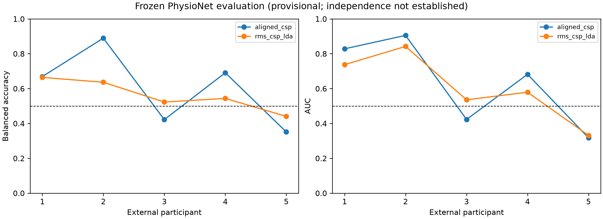
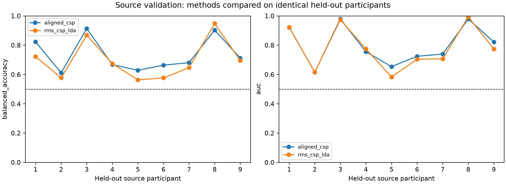
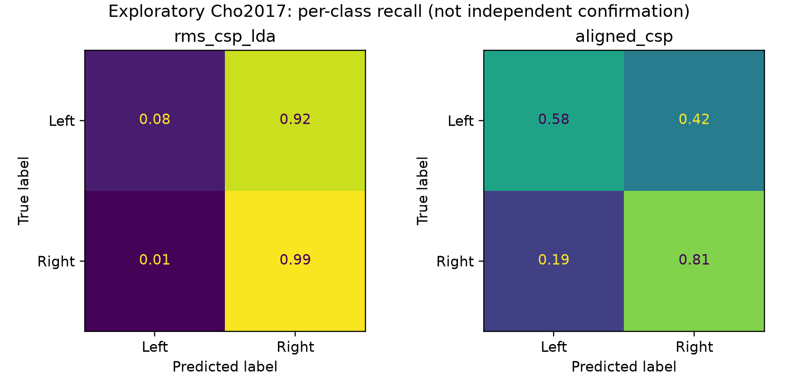

# Reliable motor imagery EEG transfer through verified event timing and label-free participant alignment

**Draft preprint — not peer reviewed.** Hosted in this repository; no preprint-server submission or DOI is claimed. Results are exploratory or provisional, and the research hypotheses are retrospective rather than preregistered. See the [preprint overview](PREPRINT.md).

## Abstract

Motor imagery EEG classifiers can retain class ranking while their decision boundaries fail across recording datasets. We repaired a CPU-based research pipeline, verified BNCI2014-001 trial/cue timing, and evaluated a small set of spatial-filter and covariance methods using participant-separated source validation. In nine source participants (2,592 binary trials), RMS-normalized CSP with shrinkage LDA achieved mean leave-one-participant-out balanced accuracy 0.696 (95% participant bootstrap interval 0.619–0.784). A fixed, regularized participant-alignment variant achieved 0.733 (0.665–0.808). After source-only selection, the frozen aligned model achieved balanced accuracy 0.695 and ROC-AUC 0.787 on previously examined Cho2017 participant 1, compared with 0.535 and 0.761 for RMS/CSP. Alignment used unlabeled participant batches, not target labels; it is therefore unsupervised adaptation rather than strict inductive inference. These exploratory results establish a technically reproducible pipeline and a promising transfer method, and a subsequently authorized frozen PhysioNet evaluation remained provisional because cohort exposure was unconfirmed. Across five PhysioNet participants, aligned CSP achieved mean balanced accuracy 0.604 (95% participant interval 0.433–0.766) versus 0.561 for RMS/CSP; the paired difference interval included zero. Reliable cross-dataset population improvement is not established.

## Introduction

A motor imagery decoder that requires supervised calibration for every user has limited portability. Generalization across participants already presents anatomical and physiological differences; an independent dataset adds recording references, amplifiers, units, cue semantics, task protocols and artifact distributions. AUC alone can obscure practical failures: a model may rank classes above chance while a displaced decision boundary predicts almost exclusively one class. Historical BNCI-to-Cho analyses showed this pattern. We addressed both software validity and a focused set of normalization methods, retaining negative findings and separating development from independent confirmation.

## Methods

### Data preservation and event verification

Original scripts, experiment outputs and models were archived before rescue changes. The archive checksum remains unchanged; a second snapshot preserves the first rescue implementation. Historical numbered scripts are retained as evidence rather than claimed to be supported execution paths.

The original competition specification places trial start at zero and imagery cue onset two seconds later. Its GDF definitions distinguish code 768 from cue codes 769–772. In the cached BNCI MATLAB representation, `trial` values are one-based; the installed MOABB converter assigns class triggers to `trial - 1`, while the dataset's imagery interval is [2,6] seconds. We checked converted event indices and labels against every MATLAB run (108 runs, 18 files). For the first run of every file, extracted epoch values were also checked against direct slices of independently filtered continuous data. The intended 0.5–2.5-second post-cue window is therefore implemented as 2.5–4.5 seconds after these trial-start markers. An original GDF file was not available locally; direct GDF-to-MAT timestamp equivalence was not measured.

### Participants and preprocessing

Both sessions of BNCI participants 1–9 were source data. Left/right imagery labels were encoded 1/2, yielding 288 trials per participant and 2,592 overall. The same 22 electrodes were ordered explicitly, converted to volts and average referenced. Continuous source runs were filtered at 8–30 Hz and epoched at 250 Hz into 501 samples. Runs were never joined before filtering. Artifact flags were retained for primary comparisons and saved for sensitivity analysis; a separately tested metadata-based rejection option is available. No participant was excluded because of decoding performance.

Cho2017 participant 1 was already examined historically and was used only for exploratory inference. Original seven-second trial blocks were processed separately, avoiding the legacy loader's zero-buffered concatenation. MATLAB microvolts were converted to volts, the same 22 electrodes were selected and average referenced, trials were filtered at 512 Hz, and rational resampling produced 250-Hz post-marker epochs. Cue position, trial dimensions, electrode mapping and artifact metadata were checked. Both classes contributed 100 trials. Recording-system differences and finite-trial filtering remain potential sources of mismatch.

PhysioNet EEGMMIDB was subsequently evaluated with frozen models after owner authorization, with provisional status because prior cohort exposure was not established. Its imagined unilateral fist runs are 4, 8 and 12; T1 maps to left and T2 to right. Loading, channel alignment, unit scale, referencing, resampling and label-count checks were executed on cached S001–S005 before model predictions. The later evaluation included 45 trials from each participant, 225 in total. Prior use remains unknown; the absence of historical script references was not treated as proof of independence.

### Models and source validation

The initial fixed comparison included regularized four-component CSP/LDA, OAS-covariance Riemannian MDM, trial RMS/CSP/shrinkage LDA, trace-normalized OAS/MDM and trace-normalized tangent-space/shrinkage LDA. Every fitted transformation used only the training participants. Scores were signed toward right imagery with a fixed zero threshold; predictions were never forced to balance.

A separate three-outer-fold, three-inner-fold participant-level experiment compared RMS/CSP with four components against four-band CSP with two or four components per band. The bands were 8–12, 12–18, 18–24 and 24–30 Hz, filtered continuously before epoching. Inner selection maximized participant-mean balanced accuracy. A fixed RMS/CSP comparator used identical outer splits. Average reference removes one spatial degree of freedom. Precision checks exposed an unstable numerical component when float32 compression was combined with automatic rank estimation. The corrected implementation retains float64 data, reapplies the reference and specifies CSP rank as the number of channels minus one. Earlier float32 filter-bank runs are superseded and not used as final evidence.

### Label-free participant alignment

We evaluated one additional fixed method motivated by Euclidean alignment (He and Wu). Each participant's trials were RMS normalized and temporally demeaned. Trial covariance matrices were trace normalized and averaged. A fixed 1% identity loading, scaled by channel count, regularized the reference before inverse-square-root whitening. A four-component regularized CSP and shrinkage LDA were then trained on aligned source participants. Held-out participants were aligned independently from their unlabeled trials. The alignment function accepts no labels.

This is a regularized variant, not an exact reproduction of the original algorithm. It uses an unlabeled target batch and is explicitly transductive: batch composition can affect predictions. It does not satisfy a stronger requirement of single-trial inference with no target-side estimation. Selection between fixed aligned CSP and RMS/CSP used matched source LOSO balanced accuracy before aligned Cho predictions were generated. This comparison is exploratory source development, not a nested unbiased estimate of a complete selection procedure. The alignment experiment was initiated after earlier exploratory Cho failure was observed; no independence is claimed for Cho.

### Metrics and reproducibility

We report participant-mean balanced accuracy, ROC-AUC, left/right recall, prediction prevalence, trial identities and participant-level results. Percentile 95% intervals use 10,000 participant bootstrap resamples with seed 20261023. Paired source comparisons use matched participant differences. These intervals do not correct repeated development, winner selection or multiple comparisons. No population-level interval is inferred from the single exploratory external participant.

Saved models are checksum checked and reloaded before repeated predictions. An independent output-verification pass recomputes every saved participant metric and checks matched cohorts, duplicate identities, finite scores and valid labels. Twenty automated tests cover dataset fixtures, timing, class mapping, artifact policies, rank/precision, participant-separated folds, score orientation, gain invariance, serialization, participant-batch isolation, bootstrap reproducibility and corrupt outputs. A fresh virtual environment was installed offline from pinned cached wheels and tested from outside the repository, with no inherited project environment. Its installed package also ran real Cho inference. Final workflow reproducibility evidence is saved with the curated results.

## Results

### Source LOSO development

| Model | Balanced accuracy (95% participant interval) | ROC-AUC | Left recall | Right recall |
|---|---:|---:|---:|---:|
| CSP/LDA | 0.611 (0.537–0.710) | 0.712 | 0.796 | 0.427 |
| OAS/MDM | 0.582 (0.538–0.627) | 0.755 | 0.682 | 0.481 |
| RMS/CSP/shrinkage LDA | 0.696 (0.619–0.784) | 0.783 | 0.656 | 0.737 |
| Trace OAS/MDM | 0.645 (0.580–0.716) | 0.797 | 0.697 | 0.594 |
| Trace tangent/shrinkage LDA | 0.685 (0.615–0.756) | 0.770 | 0.704 | 0.667 |
| Aligned RMS/CSP/shrinkage LDA | **0.733 (0.665–0.808)** | **0.799** | 0.731 | 0.735 |

The aligned method improved source balanced accuracy by 3.70 percentage points over the matched RMS/CSP comparator. Source selection remains optimistic and does not prove an external improvement. Participant heterogeneity persists. In the corrected nested filter-bank experiment, selected models achieved mean balanced accuracy 0.6817 (95% participant interval 0.5930–0.7758), compared with 0.7029 (0.6246–0.7890) for fixed RMS/CSP on the same outer folds. Their respective ROC-AUC values were 0.7560 and 0.7695. Final full-source selection retained RMS/CSP. These three-fold estimates must not be treated as equivalent to nine-fold LOSO.

### Exploratory source-to-Cho transfer

| Frozen method | Balanced accuracy | ROC-AUC | Left recall | Right recall | Predicted right |
|---|---:|---:|---:|---:|---:|
| RMS/CSP/shrinkage LDA | 0.535 | 0.7607 | 0.08 | 0.99 | 0.955 |
| Aligned RMS/CSP/shrinkage LDA | **0.695** | **0.7874** | **0.58** | **0.81** | **0.615** |

Both aligned predictions and scores reproduced after model reload. Its 139 correct predictions out of 200 equal balanced accuracy here because both classes have 100 trials. The result is descriptive for one historically exposed participant. It does not establish independent population generalization, and no external-label threshold tuning was performed. Raw MDM remained a negative baseline: it had AUC 0.7747 while predicting right imagery for every trial.

### Provisional frozen PhysioNet evaluation

The owner authorized the external evaluation after all source model selection was complete. A protocol with model hashes, primary endpoint, participant list and fixed thresholds was saved before target inference. The primary selected model was aligned CSP; its comparator was the previously frozen RMS/CSP model. No weights, thresholds, participants or labels were changed based on the outcomes.

| Method | Mean balanced accuracy (95% participant interval) | Mean ROC-AUC (95% interval) | Left recall | Right recall |
|---|---:|---:|---:|---:|
| Aligned CSP | 0.6044 (0.4332–0.7658) | 0.6311 (0.4325–0.8296) | 0.5528 | 0.6561 |
| RMS/CSP | 0.5614 (0.4940–0.6289) | 0.6050 (0.4534–0.7597) | 0.5834 | 0.5394 |

The paired balanced-accuracy difference was 0.0430 (95% participant-bootstrap interval −0.0750 to 0.1634). This interval includes zero, and the selected model's accuracy interval includes chance. Aligned CSP participant balanced accuracies were 0.6690, 0.8893, 0.4219, 0.6907 and 0.3512 for S001–S005. Below-chance outcomes were retained. Both methods produced both-class predictions for each participant, without forcing a prediction balance. These results demonstrate executable transfer with substantial heterogeneity, not established reliable cross-dataset performance.

The cohort is now exposed. Its prior use was unconfirmed when predictions were opened, so the results remain provisional rather than confirmatory. Repeated predictions, metrics and source model checksums are independently checked; the complete participant table is in the external report.

## Discussion

The project now has an executable path from raw signals to frozen inference and independently reproduced metrics. Timing verification addresses an input-validity problem; normalization and alignment address distinct distribution-shift vulnerabilities. The source findings show that removing global trial gain can help, but a high AUC with strongly asymmetric recall remains possible. Participant alignment improved both class recalls in the exploratory transfer example, consistent with reducing participant-level covariance mismatch. This is a plausible mechanism rather than proof of causation.

Stronger methods were not uniformly better: the filter-bank grid did not consistently win source folds, and raw covariance MDM remained biased externally. The RMS candidate also differs from ordinary CSP/LDA in LDA regularization, so its improvement cannot be attributed solely to normalization. Trace MDM versus raw MDM is a cleaner representation ablation. Global-gain tests assess a specific nuisance and cannot establish invariance to electrode shifts, nonstationary artifacts or frequency-dependent noise.

## Limitations and independent confirmation

Nine source participants and one exploratory external participant are insufficient for broad claims. Alignment uses unlabeled target batches, and its reference depends on batch composition and class mixture. No online or clinical operation has been validated. Artifact flags are retained in primary results; artifact robustness is not guaranteed. Cue timing is supported by raw MATLAB/installed-loader agreement and the original specification, with no local original GDF cross-check. Filtering boundaries differ across datasets. Repeated development and selection bias remain even where folds separate participants.

The owner approved evaluation of the five cached PhysioNet participants, but their prior exposure was not confirmed. The completed evaluation is provisional and its wide intervals do not support reliable population improvement. These participants are now exposed; further method changes require a fresh independent cohort for confirmation. The current work demonstrates a verified research implementation and exploratory transfer evidence, not confirmed successful cross-dataset generalization.

## Reproducibility and references

Run the single `python -m calibrationfreebci workflow --out runs/new_run` command using the documented project interpreter and local datasets. Protocols, raw-file hashes, pinned dependencies, selected model checksums, predictions and verification reports accompany the outputs. Joblib artifacts require trusted provenance.

1. [Brunner et al., original BCI Competition IV dataset 2a specification](https://www.bbci.de/competition/iv/desc_2a.pdf).
2. [BNCI2014-001 documentation](https://moabb.neurotechx.com/docs/generated/moabb.datasets.BNCI2014_001.html).
3. [Schalk, PhysioNet EEG Motor Movement/Imagery Dataset](https://physionet.org/content/eegmmidb/1.0.0/).
4. [He and Wu, Transfer Learning for Brain–Computer Interfaces: A Euclidean Space Data Alignment Approach](https://arxiv.org/abs/1808.05464).
