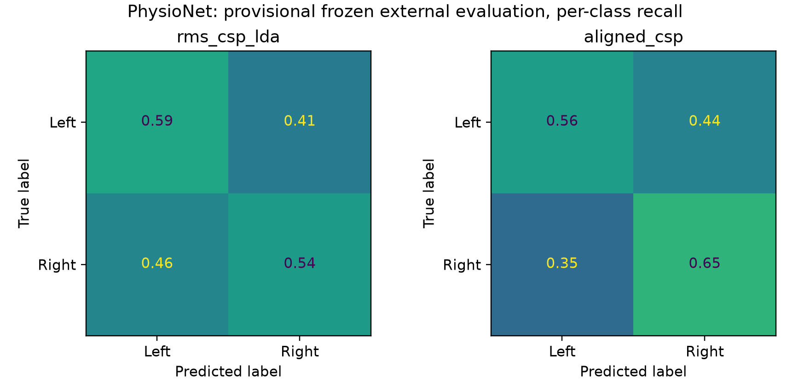

# Frozen BNCI-to-PhysioNet external evaluation

Evaluation kind: **provisional**. Cohort independence: **not established**.

Primary model fixed before predictions: `aligned_csp`. 5 participants, 225 trials total.
No model refitting, threshold adjustment, participant exclusions, label flipping or target-label selection was performed.
Alignment estimates a separate reference from each participant's unlabeled batch; it is transductive adaptation.

| Model | Participant-mean balanced accuracy (95% CI) | ROC-AUC (95% CI) | Left recall | Right recall |
|---|---:|---:|---:|---:|
| aligned_csp | 0.6044 (0.4332–0.7658) | 0.6311 (0.4325–0.8296) | 0.5528 | 0.6561 |
| rms_csp_lda | 0.5614 (0.4940–0.6289) | 0.6050 (0.4534–0.7597) | 0.5834 | 0.5394 |

## Paired comparison

Selected model minus `rms_csp_lda`: 0.0430 balanced accuracy; participant-bootstrap 95% interval [-0.0750, 0.1634].

## Participant outcomes

| Participant | Method | Balanced accuracy | ROC-AUC | Left recall | Right recall | Predicted right |
|---|---|---:|---:|---:|---:|---:|
| S001 | aligned_csp | 0.6690 | 0.8281 | 0.5652 | 0.7727 | 0.6000 |
| S001 | rms_csp_lda | 0.6640 | 0.7372 | 0.7826 | 0.5455 | 0.3778 |
| S002 | aligned_csp | 0.8893 | 0.9051 | 0.8696 | 0.9091 | 0.5111 |
| S002 | rms_csp_lda | 0.6364 | 0.8419 | 1.0000 | 0.2727 | 0.1333 |
| S003 | aligned_csp | 0.4219 | 0.4229 | 0.4348 | 0.4091 | 0.4889 |
| S003 | rms_csp_lda | 0.5227 | 0.5356 | 1.0000 | 0.0455 | 0.0222 |
| S004 | aligned_csp | 0.6907 | 0.6818 | 0.6087 | 0.7727 | 0.5778 |
| S004 | rms_csp_lda | 0.5435 | 0.5791 | 0.0870 | 1.0000 | 0.9556 |
| S005 | aligned_csp | 0.3512 | 0.3175 | 0.2857 | 0.4167 | 0.5556 |
| S005 | rms_csp_lda | 0.4405 | 0.3313 | 0.0476 | 0.8333 | 0.8889 |

## Interpretation

The selected model's balanced-accuracy interval includes chance. Paired comparison intervals are reported above. A small cohort cannot establish broad population reliability. All below-chance participant outcomes were retained without flipping labels or predictions.
Evaluation kind is provisional; cohort independence is not established. This cohort is now exposed and must not guide model changes presented as fresh confirmation on the same cohort.
All intervals resample participants (10,000 draws; seed 20261023). Small-cohort bootstrap intervals do not provide strong population guarantees.

